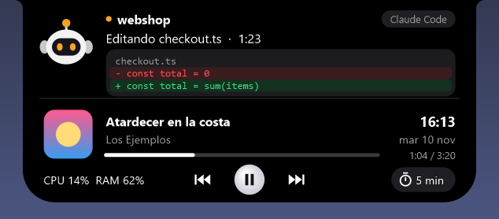
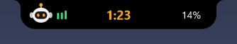
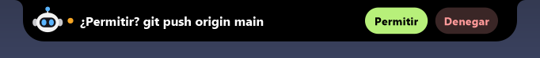
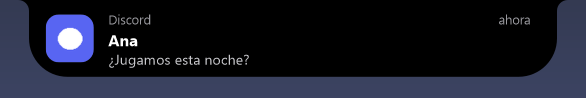
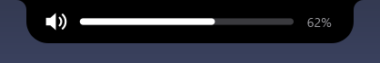
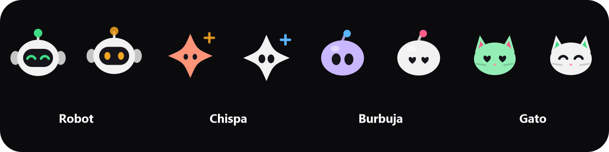

# Isla dinámica para Windows

Una píldora negra pegada arriba al centro de la pantalla, estilo Dynamic Island, conectada a **Claude Code**. Código abierto (MIT).



## Instalar

**Fácil:** descarga `IslaDinamica-Setup.exe` desde [Releases](../../releases), ábrelo y pulsa **Instalar**. No hace falta Python ni permisos de administrador. Se instala en `%LOCALAPPDATA%\Programs\IslaDinamica`, se conecta con Claude Code, arranca sola con Windows y se actualiza sola cuando hay versión nueva. Se desinstala desde *Configuración → Aplicaciones*.

> Windows puede mostrar "Windows protegió su PC" porque el .exe no está firmado: *Más información → Ejecutar de todas formas*.

**Desde el código:**

```
pip install -r requirements.txt
python install_hooks.py      # conecta con Claude Code (python install_hooks.py --remove para quitar)
pythonw island.py
```

## Qué hace

**Claude Code**
- Un robot muestra qué hace Claude: pensando, leyendo, editando (con el diff), ejecutando comandos… Sus ojos cambian con el ánimo: listo, trabajando, te necesita, permiso aprobado, sin sesiones.
- Mientras trabaja, la isla cerrada muestra cuánto lleva; al terminar se abre unos segundos, suena un aviso y dice cuánto tardó.
- Los pedidos de permiso aparecen en la isla con **Permitir** y **Denegar**. Si no respondes en 100 s, la pregunta vuelve a la terminal.
- Cuando Claude termina, el botón **Responder** deja escribirle la siguiente instrucción desde la isla, sin ir a la terminal.
- Cuando Claude te hace una pregunta con opciones, aparece en la isla con un botón por opción (o *En la terminal*).
- Muestra el avance de su lista de tareas ("Tareas 3/7") y cuántos archivos cambió al terminar.
- Varias sesiones: clic en **‹ 1/2 ›** para cambiar. Clic en el nombre del proyecto o en el robot para traer su terminal al frente.

| | |
|---|---|
|  |  |
|  |  |

**Chat con Claude**
- Pregúntale lo que quieras sin salir de lo que estás haciendo: doble clic en el personaje, clic derecho → *Preguntarle a Claude…*, desde la bandeja o con un atajo propio.
- Usa tu plan de Claude Code (Pro/Max) con la sesión que ya tienes iniciada: **no hace falta API key**. Claude solo conversa (sin herramientas, no toca archivos) y recuerda la conversación hasta que pulsas *Nueva*.
- La respuesta aparece mientras Claude la escribe, con formato (negritas, listas, código) y botón *Copiar*.
- Pega una captura con Ctrl+V (o pulsa *Preguntar* en la tarjeta de captura) para preguntarle por ella.

- **Dictar**: habla en vez de escribir (usa el dictado de Windows, Win+H).

**Recordatorios**
- Escribe en el chat "recuérdame en 20 min sacar la ropa", "avísame a las 18:30 que llame a mamá" o "recuérdame mañana a las 9 pagar la luz": la isla te avisa con tarjeta y sonido (con *+10 min* para posponer). Se ven y se borran con clic derecho → Recordatorios.

**Personajes**



Robot, Chispa, Burbuja o Gato, en seis colores. Respiran, parpadean, te siguen con la mirada, saltan si les haces clic o cuando Claude termina, y se duermen si dejas la PC un rato. En el modo **Solo compañero** no hay tarjeta de Claude Code: el personaje te acompaña y reacciona a la música, las notificaciones y la hora.

**Además**
- Música (Spotify, navegador…) con carátula, barra de progreso y botones animados.
- Notificaciones de Windows (WhatsApp, Discord, correo…) unos segundos; clic para descartar.
- Barra al cambiar el volumen o el brillo.
- Avisos al conectar el cargador, auriculares o una memoria USB (clic para abrirla).
- Captura de pantalla (Win+Shift+S): vista previa con **Guardar** y **Abrir**. Opcional: ver el texto que copias (nunca lo que marcan como privado los gestores de contraseñas).
- Punto naranja/verde junto a la isla mientras una app usa el micrófono o la cámara, con botón para silenciar el micrófono.
- Enfoque (pomodoro 25 + 5): clic derecho → Empezar enfoque. Un anillo alrededor del personaje muestra el avance.
- Clima junto al reloj y tu próxima cita del calendario de Windows, con aviso 10 minutos antes.
- Reloj, fecha, batería en laptops; CPU y RAM en PCs de escritorio.
- Temporizador: rueda del mouse = minutos, clic = iniciar/parar.
- Color de acento, modo translúcido y tres tamaños. Nítida en pantallas con escala 125–200 %.
- Fondos: negro, vidrio, aurora (colores que se mueven) o con el color de la carátula que suena.
- Elige qué bloques se ven en la isla abierta (Claude Code, música, hoy, sistema, tu día) y en qué orden.
- "Tu día": cuánto trabajó Claude, rondas de enfoque y canciones; resumen a las 21:30. Se guarda solo en tu PC.
- Atajos de teclado propios para mostrar/ocultar, enfoque, música, ajustes y chat.
- En español o inglés (automático según Windows).

**Uso**
- Pasa el mouse para expandir.
- Gestos sobre la música: desliza para cambiar de canción, doble clic para abrir la app que suena. La rueda del mouse cambia el volumen (sobre el temporizador, los minutos).
- Mostrar u ocultar: clic en el robot de la bandeja de Windows o **Ctrl+Alt+I**. Oculta, los permisos se responden en la terminal.
- **Ajustes** (clic derecho → Ajustes…, o desde la bandeja): personaje con vista previa, colores, modo, tamaño, en qué pantalla aparece (también puede seguir al mouse) y qué mostrar. Los cambios se ven al instante.
- La isla nunca te saca de la aplicación en la que estás.

## Privacidad

Claude Code le avisa a la isla por `127.0.0.1` (puerto 47823): eso no sale de tu PC. Si la isla está cerrada, Claude Code funciona normal.

La isla solo se conecta a internet para dos cosas, y las dos se pueden apagar con clic derecho:
- **Clima** (*Mostrar → Clima*): manda tu ubicación de Windows **redondeada a ~10 km** a [Open-Meteo](https://open-meteo.com), cada 30 minutos.
- **Actualizaciones** (*Buscar actualizaciones*): consulta los Releases de este repositorio en GitHub cada 6 horas.

## Desarrollo

- Tests: `python test_island.py` y `python test_visual.py` (dibuja todos los estados; `ISLA_LANG=en` para inglés)
- Armar el instalador: `pip install pyinstaller` y `python build.py` → `dist/IslaDinamica-Setup.exe`

| Archivo | Qué es |
|---|---|
| `island.py` | La isla (tkinter + cairo sobre una ventana con transparencia por píxel) |
| `claude_hook.py` | Hook que Claude Code ejecuta en cada evento; se lo pasa a la isla |
| `install_hooks.py` | Agrega/quita los hooks en `~/.claude/settings.json` (deja copia `.bak`) |
| `sistema.py`, `servicios.py`, `claude.py`, `dibujo.py` | Windows, servicios de fondo, Claude Code y dibujo |
| `ajustes.py`, `chat.py`, `textos.py`, `registro.py` | Ventana de ajustes, chat, idiomas y registro de errores |
| `app.py`, `instalador.py`, `build.py` | El .exe, el instalador y cómo se arman |

Licencia MIT.
